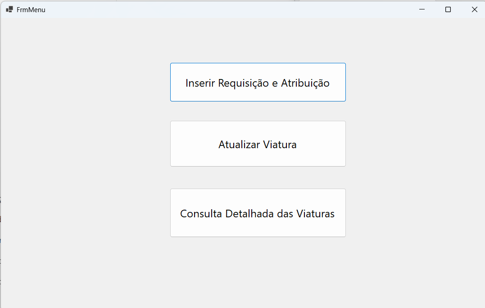
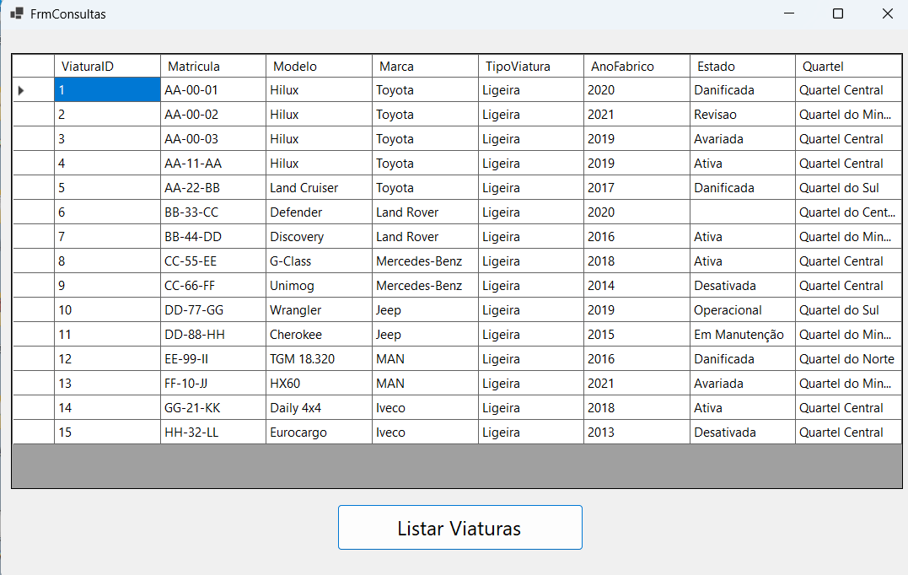
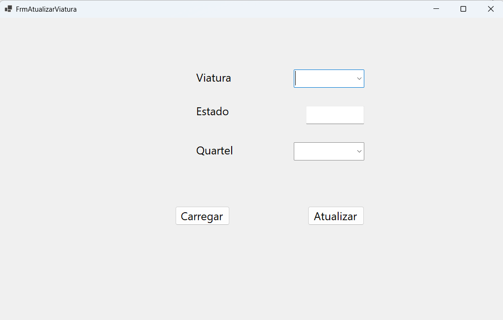
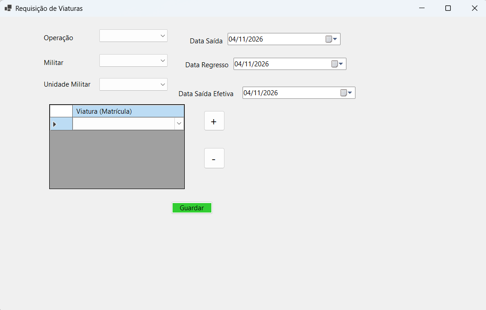
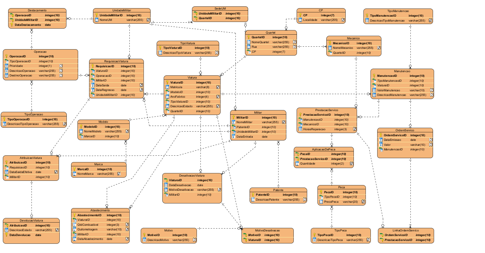

# Military Fleet Manager

C# Windows Forms source code for managing military vehicles, updating their status and barracks, and creating vehicle requisitions in batches through SQL Server.

[Português](README.pt-PT.md)

> **Project status:** the .NET 10 Windows Forms project, solution, Designer files and resources have been restored from the Stage 4 submission. Analytical SQL queries, the stored procedure and application screenshots are included. The database creation script is included; sample data is still missing, so a fresh database starts empty. Compilation and end-to-end execution have not yet been verified in this environment.

## Features represented in the source

- **Fleet overview:** query vehicles with registration, model, brand, type, manufacture year, status and barracks.
- **Vehicle updates:** change a vehicle's status and assigned barracks using parameterized SQL.
- **Batch requisitions:** select an operation, military member, unit and multiple vehicles; reject duplicate vehicles and empty selections.
- **Transactional writes:** call `sp_CriarRequisicaoEAtribuicao` for each selected vehicle in one SQL transaction, committing the batch on success or attempting rollback on failure.
- **Connection check:** display database connectivity information when the main menu opens.

These describe the available code, not a verified end-to-end release. The stored procedure is included and its seven parameters and scalar return match the application call.

## Application screenshots

Screenshots supplied by the author, including the fleet query with loaded records.

### Main menu



### Fleet overview



### Vehicle updates



### Requisitions and assignments



## Technology

| Component | Technology |
| --- | --- |
| Language | C# |
| Desktop interface | Windows Forms |
| Database | Microsoft SQL Server |
| Data access | ADO.NET with `Microsoft.Data.SqlClient` |
| Data binding | `DataTable` and `DataGridView` |

The restored project targets **.NET 10 for Windows** (`net10.0-windows`) and references **Microsoft.Data.SqlClient 6.1.3**.

## Source guide

| File | Responsibility |
| --- | --- |
| [Program.cs](Program.cs) | Application entry point |
| [FrmMenu.cs](FrmMenu.cs) | Navigation and database connection check |
| [FrmConsultas.cs](FrmConsultas.cs) | Joined fleet query and results display |
| [FrmAtualizarViatura.cs](FrmAtualizarViatura.cs) | Vehicle status and barracks updates |
| [FrmRequisicoesLote.cs](FrmRequisicoesLote.cs) | Batch selection, validation and transaction |
| [Db.cs](Db.cs) | Query and command helpers |

## Build and run

On Windows, install the **.NET 10 SDK**. For visual editing, use Visual Studio with .NET 10 support and the **.NET desktop development** workload.

```powershell
git clone https://github.com/Filipe-Alexandre-Fernandes/Military-Fleet-Manager.git
cd Military-Fleet-Manager
dotnet restore GestaoViaturasWinForms.csproj
dotnet build GestaoViaturasWinForms.csproj --configuration Release
```

You can also open [GestaoViaturasWinForms.slnx](GestaoViaturasWinForms.slnx) in a compatible Visual Studio version.

Before running, follow the database setup below: create the schema, install the stored procedure and load suitable sample data. The [analytical queries](sql/Militares-Querys.sql) query existing records; they do not populate the database. Configure the connection in both [Db.cs](Db.cs) and [FrmRequisicoesLote.cs](FrmRequisicoesLote.cs), then run:

```powershell
dotnet run --project GestaoViaturasWinForms.csproj
```

These commands are the intended workflow; a successful build and database run have not been verified here.

The current source uses a local SQL Server instance, the `GestaoViaturasAtual` database and Windows integrated authentication. Its `TrustServerCertificate=True` setting should be reviewed for any environment beyond local development.

## Database model

The original schema diagram shows the relationships between vehicles, military personnel, units, operations, requisitions, maintenance and service orders.

[Open the full-size diagram](docs/database-schema.png)



The image preserves the academic model's original labels and type notation. Use [sql/AAD.sql](sql/AAD.sql) as the reference for the SQL Server implementation, including exact data types and constraints.

## Database setup

Use SQL Server Management Studio with an account allowed to create databases and objects. Run the scripts in this order:

1. Run [sql/AAD.sql](sql/AAD.sql) to create `GestaoViaturasAtual`, **29 tables** and **37 foreign keys**. The supplied DDL is preserved. Run it only for a fresh installation: it has no existence checks and is not a migration for an existing database.
2. Open [sql/Stored-Procedure-Requisicao-Atribuicao.sql](sql/Stored-Procedure-Requisicao-Atribuicao.sql). For this first installation, replace the initial `ALTER PROCEDURE` declaration with `CREATE PROCEDURE`, then execute the script. Keep `ALTER PROCEDURE` when updating an existing procedure.
3. Load suitable sample data before testing the interface. No seed script is included. Populate referenced records before dependent records: for example, `Marca` before `Modelo`, `CP` before `Quartel`, and `Modelo`, `TipoViatura` and `Quartel` before `Viatura`. Requisitions also require `Operacao`, `Militar` and `UnidadeMilitar` records.

After schema creation alone, lists and selection controls will be empty. The screenshots show a populated database; their records are not included in the schema script.

Static checks confirmed that all foreign key tables and columns exist and that the procedure's insert columns exist in the schema. SQL Server execution has not been verified in this environment.

## SQL queries

[sql/Militares-Querys.sql](sql/Militares-Querys.sql) contains the supplied queries for the ten assignment questions, including alternative solutions. Query logic is preserved; the original Windows encoding has been converted to UTF-8.

Open the file in SQL Server Management Studio, select the existing `GestaoViaturasAtual` database, and execute the desired query selection. The script contains no `USE` statement. Queries using `GETDATE()` depend on the SQL Server's current date.

These are analytical queries, **not an installation script**. They also reference tables beyond those used by the desktop interface. The schema and stored procedure are included separately; initial data still needs to be supplied. Results have not been validated against a running SQL Server database.

## Stored procedure

[Stored-Procedure-Requisicao-Atribuicao.sql](sql/Stored-Procedure-Requisicao-Atribuicao.sql) inserts a requisition into `RequisicaoViatura`, inserts its assignment into `AtribuicaoViatura`, and returns the new requisition ID through `SELECT`. Its parameters match the WinForms call.

The supplied script is preserved, with encoding normalized to UTF-8. It selects `GestaoViaturasAtual` and uses **ALTER PROCEDURE**, so that database, its tables and the procedure must already exist. To install it for the first time after creating the schema, change `ALTER PROCEDURE` to `CREATE PROCEDURE` before executing the script in SQL Server Management Studio. This script does not create tables or sample data.

The procedure starts a transaction and rolls back on error. The application also wraps the batch in a transaction; database error paths and rollback interaction still require integration testing. The script has been reviewed against the calling code, but has not been executed in this environment.

## Database dependencies

The source references these tables:

`Viatura`, `Modelo`, `Marca`, `TipoViatura`, `Quartel`, `Operacao`, `Militar` and `UnidadeMilitar`.

Batch creation expects `sp_CriarRequisicaoEAtribuicao` to accept:

`@ViaturaID`, `@OperacaoID`, `@MilitarID`, `@UnidadeMilitarID`, `@DataSaida`, `@DataRegresso` and `@DataSaidaEfetiva`.

The caller reads a scalar result and converts it to the created requisition ID. The schema, constraints and procedure behavior must be checked against the original database.

## Next steps

- [x] Restore the project, solution and Designer resources.
- [x] Include the stored procedure.
- [x] Include the database and table creation script.
- [ ] Add sample data.
- [ ] Centralize the connection string in configuration.
- [ ] Add date-order validation and clearer handling of connection failures.
- [ ] Add automated tests for validation and transactional behavior.
- [x] Include application screenshots supplied by the author.
- [ ] Add a short demonstration video.
- [ ] Document a verified installation process and supported versions.

## Background

Academic project for **Armazenamento e Acesso a Dados** (January 2026), by **Ana Rita Ranito, Filipe Fernandes and Nuno Araújo**.

[Stage 4 report](docs/relatorio-etapa-4.pdf) includes the project description, data model and interface screenshots.

Repository maintained by [Filipe Fernandes](https://github.com/Filipe-Alexandre-Fernandes). The repository's original identifier is **AAD**; the application namespace remains `GestaoViaturasWinForms`.

## License

No license file is currently included.

