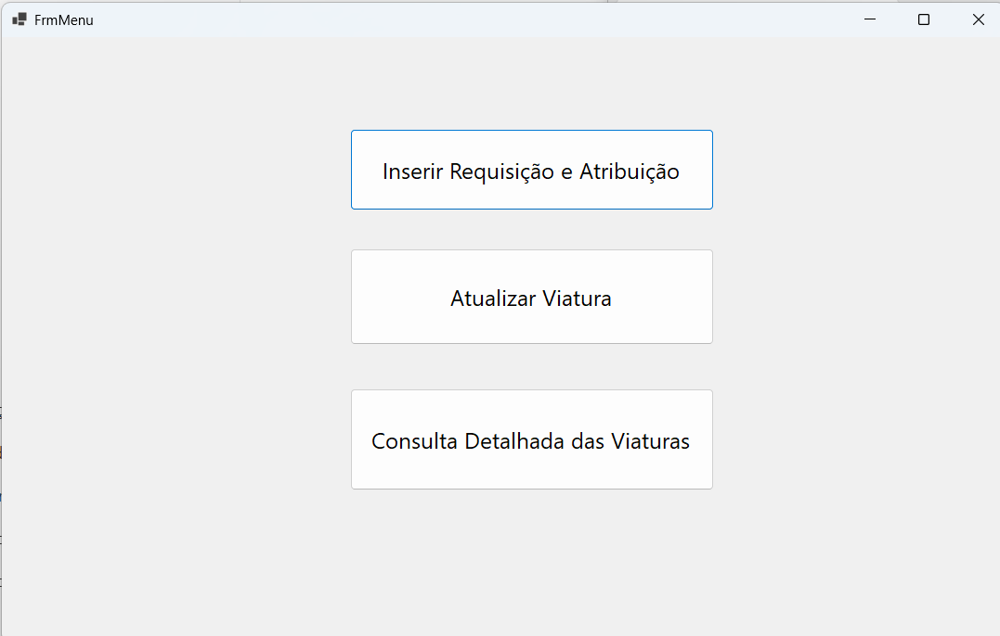
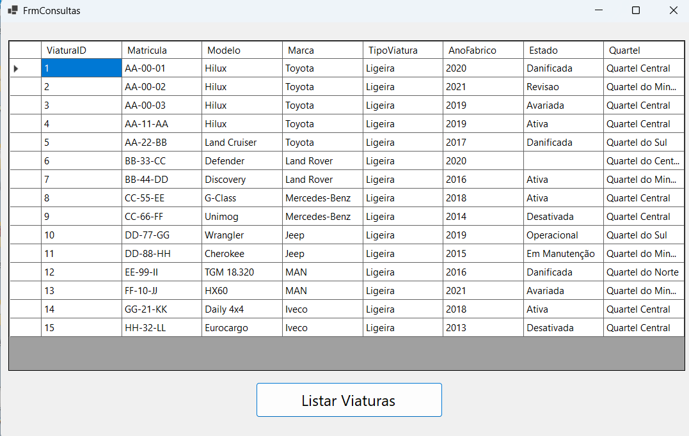
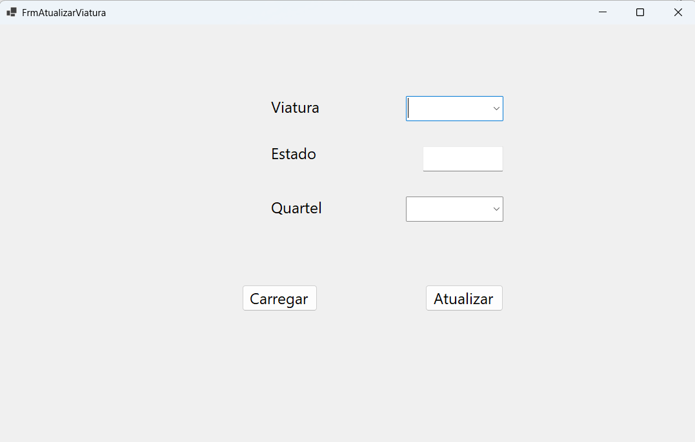
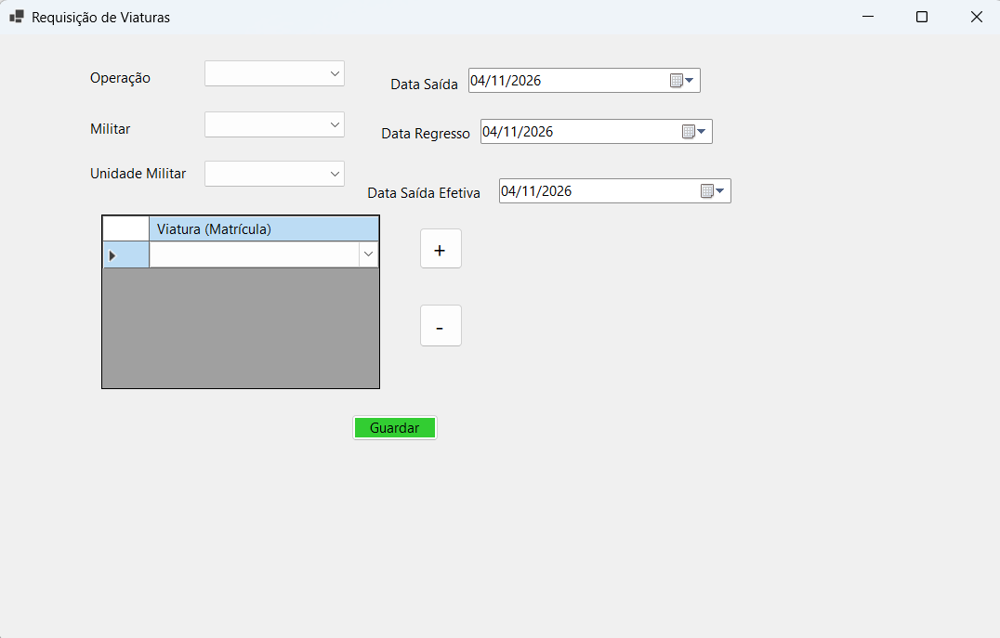

# Military Fleet Manager — Gestão de Viaturas Militares

Código C# de uma aplicação Windows Forms para consultar viaturas militares, atualizar o estado e o quartel e criar requisições de viaturas em lote através de SQL Server.

[English](README.md)

> **Estado do projeto:** o projeto Windows Forms em .NET 10, a solução, os Designer e os recursos foram recuperados da entrega da Etapa 4. As consultas SQL analíticas, o procedimento armazenado e as imagens da aplicação estão incluídos. Continuam a faltar os scripts de criação da base de dados/tabelas e os dados iniciais, pelo que uma instalação de raiz depende da base de dados original. A compilação e a execução completa ainda não foram verificadas neste ambiente.

## Funcionalidades presentes no código

- **Consulta da frota:** matrícula, modelo, marca, tipo, ano de fabrico, estado e quartel.
- **Atualização de viaturas:** alteração do estado e do quartel com SQL parametrizado.
- **Requisições em lote:** seleção de operação, militar, unidade e várias viaturas, com validação de seleções vazias e viaturas repetidas.
- **Escrita transacional:** chamada de `sp_CriarRequisicaoEAtribuicao` para cada viatura numa única transação, com commit do lote em caso de sucesso ou tentativa de rollback em caso de erro.
- **Verificação da ligação:** apresentação do estado da ligação à base de dados ao abrir o menu.

Esta lista descreve o código disponível, não uma versão testada de ponta a ponta. O procedimento armazenado está incluído e os seus sete parâmetros e resultado escalar correspondem à chamada da aplicação.

## Imagens da aplicação

Capturas fornecidas pelo autor, incluindo a consulta com viaturas carregadas.

### Menu principal


### Consulta de viaturas


### Atualização de viaturas


### Requisição e atribuição


## Tecnologias

| Componente | Tecnologia |
| --- | --- |
| Linguagem | C# |
| Interface desktop | Windows Forms |
| Base de dados | Microsoft SQL Server |
| Acesso a dados | ADO.NET com `Microsoft.Data.SqlClient` |
| Apresentação de dados | `DataTable` e `DataGridView` |

O projeto recuperado utiliza **.NET 10 para Windows** (`net10.0-windows`) e **Microsoft.Data.SqlClient 6.1.3**.

## Organização

| Ficheiro | Responsabilidade |
| --- | --- |
| [Program.cs](Program.cs) | Ponto de entrada da aplicação |
| [FrmMenu.cs](FrmMenu.cs) | Navegação e verificação da ligação |
| [FrmConsultas.cs](FrmConsultas.cs) | Consulta da frota e apresentação dos resultados |
| [FrmAtualizarViatura.cs](FrmAtualizarViatura.cs) | Atualização do estado e do quartel |
| [FrmRequisicoesLote.cs](FrmRequisicoesLote.cs) | Seleção, validação e transação das requisições |
| [Db.cs](Db.cs) | Métodos auxiliares de consulta e execução SQL |

## Compilar e executar

Em Windows, instalar o **SDK .NET 10**. Para editar os formulários, utilizar Visual Studio com suporte a .NET 10 e a carga de trabalho **Desenvolvimento para ambiente de trabalho com .NET**.

```powershell
git clone https://github.com/Filipe-Alexandre-Fernandes/Military-Fleet-Manager---AAD-Project.git
cd Military-Fleet-Manager---AAD-Project
dotnet restore GestaoViaturasWinForms.csproj
dotnet build GestaoViaturasWinForms.csproj --configuration Release
```

Também é possível abrir [GestaoViaturasWinForms.slnx](GestaoViaturasWinForms.slnx) numa versão compatível do Visual Studio.

Antes de executar, recuperar o esquema SQL Server original e dados de demonstração adequados e instalar o [procedimento armazenado](sql/Stored-Procedure-Requisicao-Atribuicao.sql) conforme descrito abaixo. As [consultas analíticas fornecidas](sql/Militares-Querys.sql) dependem de uma base de dados existente; não criam o esquema nem o procedimento armazenado. Nenhum dos dois ZIP fornecidos inclui um backup da base de dados. Configurar a ligação em [Db.cs](Db.cs) e [FrmRequisicoesLote.cs](FrmRequisicoesLote.cs) e executar:

```powershell
dotnet run --project GestaoViaturasWinForms.csproj
```

Estes comandos descrevem o processo previsto; a compilação e a execução com a base de dados ainda não foram verificadas neste ambiente.

O código atual utiliza uma instância local de SQL Server, a base de dados `GestaoViaturasAtual` e autenticação integrada do Windows. A opção `TrustServerCertificate=True` deve ser revista para ambientes além do desenvolvimento local.

## Consultas SQL

[sql/Militares-Querys.sql](sql/Militares-Querys.sql) contém as consultas fornecidas para as dez questões do trabalho, incluindo soluções alternativas. A lógica das consultas foi preservada; a codificação original do Windows foi convertida para UTF-8.

Abrir o ficheiro no SQL Server Management Studio, selecionar a base de dados existente `GestaoViaturasAtual` e executar a seleção da consulta pretendida. O script não contém uma instrução `USE`. As consultas com `GETDATE()` dependem da data atual do SQL Server.

São consultas analíticas, **não um script de instalação**. Também referenciam tabelas além das utilizadas pela interface desktop. Continuam a ser necessários o esquema e os dados iniciais; o procedimento armazenado está agora incluído separadamente. Os resultados não foram validados numa base de dados SQL Server em execução.

## Procedimento armazenado

[Stored-Procedure-Requisicao-Atribuicao.sql](sql/Stored-Procedure-Requisicao-Atribuicao.sql) insere uma requisição em `RequisicaoViatura`, insere a respetiva atribuição em `AtribuicaoViatura` e devolve o identificador da requisição através de `SELECT`. Os parâmetros correspondem à chamada do Windows Forms.

O script fornecido foi preservado, com a codificação normalizada para UTF-8. Seleciona `GestaoViaturasAtual` e utiliza **ALTER PROCEDURE**, pelo que a base de dados, as tabelas e o procedimento já têm de existir. Na primeira instalação, depois de criar o esquema, substituir `ALTER PROCEDURE` por `CREATE PROCEDURE` antes de executar o script no SQL Server Management Studio. Este script não cria tabelas nem dados de demonstração.

O procedimento inicia uma transação e faz rollback em caso de erro. A aplicação também envolve o lote numa transação; os caminhos de erro e a interação entre os rollbacks ainda precisam de testes de integração. O script foi comparado com o código que o chama, mas não foi executado neste ambiente.

## Dependências da base de dados

O código referencia as tabelas:

`Viatura`, `Modelo`, `Marca`, `TipoViatura`, `Quartel`, `Operacao`, `Militar` e `UnidadeMilitar`.

A criação em lote espera que `sp_CriarRequisicaoEAtribuicao` aceite:

`@ViaturaID`, `@OperacaoID`, `@MilitarID`, `@UnidadeMilitarID`, `@DataSaida`, `@DataRegresso` e `@DataSaidaEfetiva`.

O código lê um resultado escalar e converte-o no identificador da requisição criada. O esquema, as restrições e o comportamento do procedimento devem ser confirmados na base de dados original.

## Próximos passos

- [x] Recuperar o projeto, a solução e os recursos do Designer.
- [x] Incluir o procedimento armazenado.\n- [ ] Recuperar o esquema SQL e dados de demonstração.
- [ ] Centralizar a configuração da ligação à base de dados.
- [ ] Validar a ordem das datas e melhorar o tratamento de falhas de ligação.
- [ ] Adicionar testes de validação e do comportamento transacional.
- [x] Incluir as imagens da aplicação fornecidas pelo autor.\n- [ ] Adicionar um vídeo curto de demonstração.
- [ ] Documentar uma instalação verificada e as versões suportadas.

## Contexto

Trabalho académico de **Armazenamento e Acesso a Dados** (janeiro de 2026), realizado por **Ana Rita Ranito, Filipe Fernandes e Nuno Araújo**.

O [relatório da Etapa 4](docs/relatorio-etapa-4.pdf) inclui a descrição do projeto, o modelo de dados e imagens da interface.

Repositório mantido por [Filipe Fernandes](https://github.com/Filipe-Alexandre-Fernandes). O identificador original do repositório é **AAD**; o namespace da aplicação mantém-se `GestaoViaturasWinForms`.

## Licença

O repositório ainda não inclui um ficheiro de licença.

